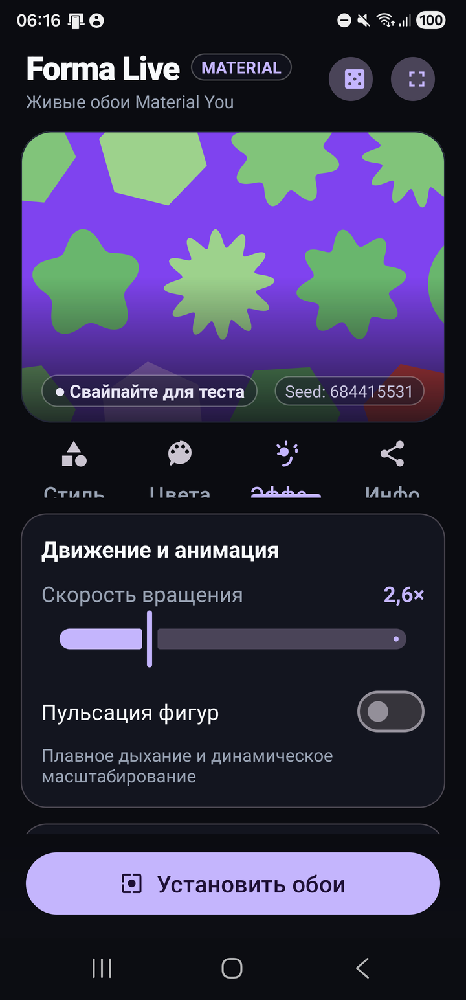
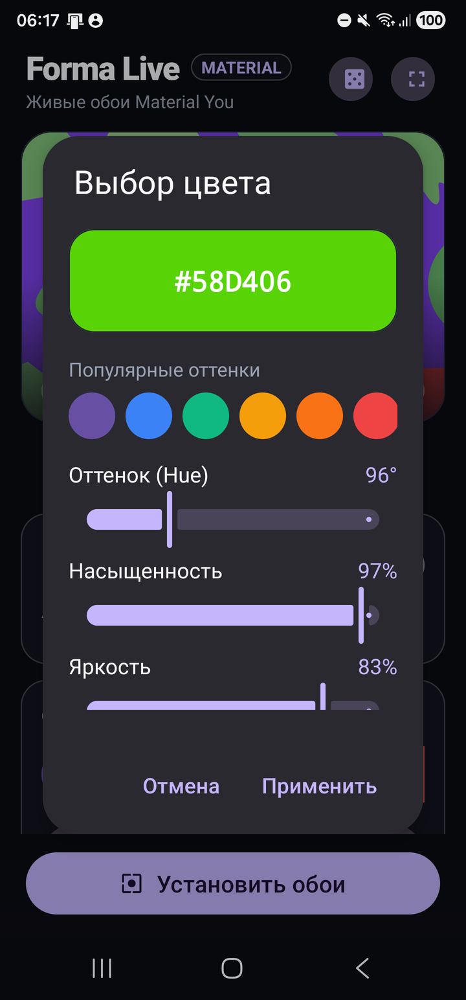
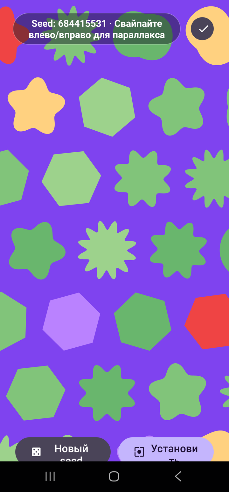
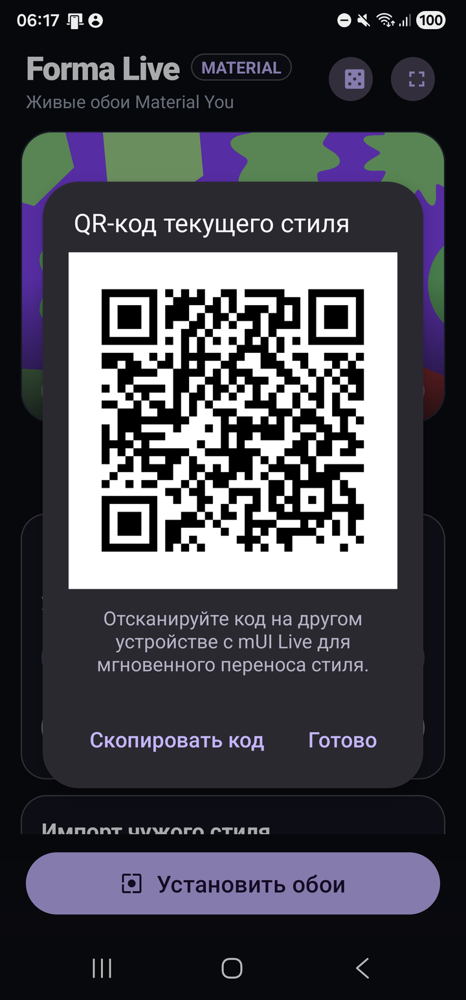

<div align="center">

# 🎨 Forma Live
### Премиальные живые обои Material You для Android

[-3DDC84?style=for-the-badge&logo=android&logoColor=white)](#)
[](#)
[](#)
[](#)
[](#)

<br/>

*Процедурная анимированная сетка геометрических фигур, полная интеграция с динамической палитрой Material You, ручная настройка спектра и ультрасовременный интерфейс с интерактивным предпросмотром.*

<br/>

| 🎨 Стиль и геометрия | 🌈 Палитра и Material You | ✨ Эффекты и оптика |
|:---:|:---:|:---:|
|  |  |  |

<br/>

| 🎯 Спектральный Color Picker | ⛶ Интерактивный Fullscreen | 📤 Обмен стилями и QR-код |
|:---:|:---:|:---:|
|  |  |  |

</div>

---

## 🚀 Демонстрация ключевых возможностей

### 1. 📐 Процедурная векторная геометрия (Без растра)
Обои не используют статичные картинки для фигур — каждая форма генерируется математически на `android.graphics.Canvas`:
- **7 математических контуров**:
  1. ⚪ **Круг** — классическая окружность.
  2. 🔲 **Сквиркл (Squircle)** — суперэллипс Ламе с мягким скруглением: $|x|^p + |y|^p = r^p$.
  3. 🌸 **Цветок (8 лепестков)** — радиальная модуляция синусоидой $r(\theta) = r_0 (1 + d \cos(8\theta))$.
  4. 🌺 **Цветок (5 лепестков)** — несимметричная органика лепестков.
  5. ⬡ **Шестиугольник** — строгая гексагональная геометрия.
  6. ☀️ **Солнце (12 лучей)** — лучевая звёздная форма.
  7. 💧 **Капля** — каплевидный контур.
- **Индивидуальная физика**: каждая фигура в сетке имеет собственный псевдослучайный сдвиг фазы, скорость и направление вращения (по или против часовой стрелки), зависящие от значения `Seed`.

---

### 2. 🎨 Динамический колорит Material You и спектр
- **Синхронизация с системой**: в режиме `Material You` приложение считывает цвет `system_accent1_500` и строит гармоничную градиентную гамму оттенков.
- **Кастомный HSV Color Picker**: интерактивный выбор оттенка (0–360°), насыщенности и яркости с отображением HEX-кодов и живым предпросмотром.
- **Многоцветная сетка**: поддержка до 3 независимых акцентных цветов для создания ярких паттернов типа «Конфетти».
- **Фон и фотографии**: переключение между сгенерированным тёмным фоном, монохромным цветом или любым пользовательским фото из галереи устройства.

---

### 3. 🌊 Интерактивный параллакс-тест
- **Отклик на свайпы**: сетка плавно реагирует на горизонтальную прокрутку экранов лаунчера с интерполяцией `lerp` к целевому смещению.
- **Свайп-тест прямо в карточке**: вам не нужно закрывать приложение и переходить на рабочий стол, чтобы оценить параллакс — просто проведите пальцем влево или вправо по карточке предпросмотра в настройках!

---

### 4. ⛶ Режим Fullscreen Sandbox
- Разворачивает обои на весь экран без системных панелей.
- Кнопка **🎲 Новый seed** позволяет на лету перебирать миллионы вариантов генерации композиции.
- Кнопка **Установить** позволяет сразу применить понравившийся результат в систему.

---

### 5. 📤 QR-коды и ультракомпактный обмен стилями
- Вся конфигурация обоев (маска фигур, цвета, скорость, глубина лепестков, размытие, шаг сетки) упаковывается в **52-байтный бинарный буфер** `ByteBuffer` и кодируется в Base64 URL-safe с контролем целостности.
- **Встроенный сканер камеры**: наведите камеру на QR-код с другого смартфона, и стиль применится мгновенно без интернета и регистрации.

---

### 6. ⚡ Бережное отношение к батарее (Zero Idle Drain)
- Служба `WallpaperService` строго отслеживает событие `onVisibilityChanged(boolean visible)`.
- Когда экран заблокирован или открыто другое приложение, таймер отрисовки (`handler.removeCallbacks`) **полностью останавливается**. Приложение потребляет **0% CPU / GPU** в фоновом режиме.

---

## 🛠️ Сборка и запуск

### Требования
- **JDK**: 21
- **Android SDK**: Platform 36 (Android 12+, `minSdk = 31`)
- **Gradle**: 9.3.1 (Wrapper включен в проект)

### Сборка Debug APK
Из папки `MUILive`:

```powershell
cd MUILive
.\gradlew.bat :app:assembleDebug
```

Готовый файл: `MUILive/app/build/outputs/apk/debug/app-debug.apk`

### Установка на подключённые устройства

```powershell
# Установка на конкретное устройство:
adb -s <DEVICE_ID> install -r MUILive/app/build/outputs/apk/debug/app-debug.apk

# Запуск приложения:
adb -s <DEVICE_ID> shell am start -n com.slimcorp.muilive/.MainActivity
```

---

## 💖 Благодарности и авторство

Проект **Forma Live** основан на оригинальном открытом проекте [mUI-Live](https://github.com/rixa8/mUI-Live).

Особая и искренняя благодарность оригинальному автору:
- 👨‍💻 **Rixa**
  - GitHub: [@rixa8](https://github.com/rixa8)
  - TikTok: [@s_l_i_m_t_e_c_h](https://www.tiktok.com/@s_l_i_m_t_e_c_h)

*Спасибо за разработку оригинальной математики контуров фигур, идеи живых обоев и вдохновение Material You!*

---

## 📄 Лицензия

Проект распространяется под открытой лицензией **MIT**. Подробности в файле [LICENSE](./LICENSE).
