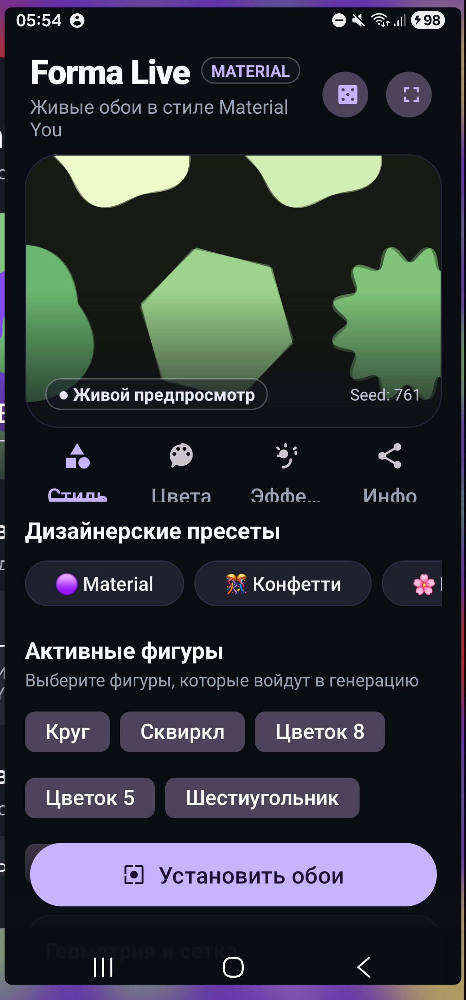
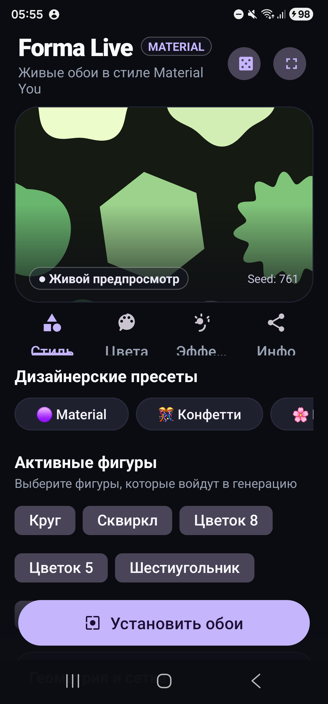
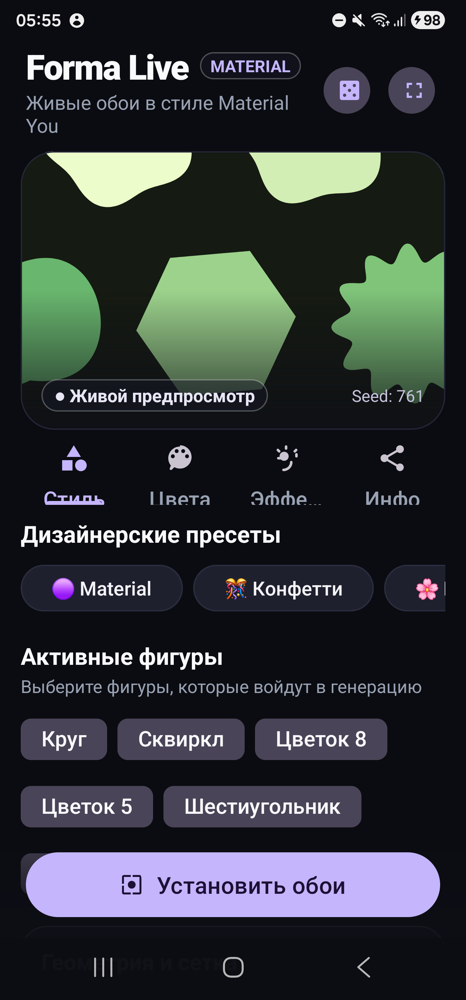

<div align="center">

# 🎨 Forma Live
### Живые обои в стиле Material You для Android

[-3DDC84?style=for-the-badge&logo=android&logoColor=white)](#)
[](#)
[](#)
[](#)

<p align="center">
  
  &nbsp;&nbsp;
  
  &nbsp;&nbsp;
  
</p>

*Процедурная сетка анимированных геометрических фигур, динамические цвета Material You, глубокая кастомизация и современный дизайнерский интерфейс.*

</div>

---

## ✨ Возможности и особенности

- 🎨 **Динамические цвета Material You**: Полная гармония с системной палитрой вашего устройства Android 12+.
- 🌈 **Собственная палитра & HSV Color Picker**: Свободный выбор базового цвета из спектра оттенков с HEX-кодами, быстрые дизайнерские пресеты и поддержка до 3 дополнительных акцентных цветов для разноцветной сетки.
- 🖼️ **Фон и фото**: Возможность установить сплошной цвет фона или выбрать любое изображение/фото из галереи.
- 📐 **7 процедурных форм фигур**: Круг, скругленный суперэллипс (*Squircle*), 8-лепестковый цветок, 5-лепестковый цветок, шестиугольник, 12-лучевое солнце и капля.
- 🔄 **Интерактивный параллакс**: Сетка реагирует на свайпы рабочих столов с плавной интерполяцией.
- 📱 **Интерактивный предпросмотр**: Проверяйте сдвиг параллакса пальцем прямо на карточке предпросмотра или разворачивайте композицию на весь экран (**⛶**).
- 🎲 **Генератор композиций**: Создавайте новые уникальные паттерны в один клик с помощью кнопки рандомизации *Seed*.
- 📤 **QR-код и экспорт настроек**: Делитесь своими стилями за секунду с помощью генерации QR-кода высокого разрешения, встроенного сканера через камеру или компактного текстового кода (52 байта Base64).
- ⚡ **Энергоэффективность**: Отрисовка на Canvas останавливается при блокировке экрана или переходе в другие приложения.

---

## 🛠️ Сборка и установка

### Требования
- **JDK**: 21
- **Android SDK**: Platform 36 (Android 12+, `minSdk = 31`)
- **Gradle Wrapper**: 9.3.1 (включен в проект)

### Сборка из командной строки

Перейдите в папку `MUILive` и запустите Gradle:

```powershell
cd MUILive
.\gradlew.bat :app:assembleDebug
```

Готовый файл APK:
`MUILive/app/build/outputs/apk/debug/app-debug.apk`

### Установка через ADB

```powershell
adb install -r MUILive/app/build/outputs/apk/debug/app-debug.apk
```

---

## 💖 Благодарности и авторство

Проект **Forma Live** развивает концепцию открытого проекта [mUI-Live](https://github.com/rixa8/mUI-Live).

Особая и искренняя благодарность оригинальному автору:
- 👨‍💻 **Rixa**
  - GitHub: [@rixa8](https://github.com/rixa8)
  - TikTok: [@s_l_i_m_t_e_c_h](https://www.tiktok.com/@s_l_i_m_t_e_c_h)

Спасибо за создание оригинальной математики процедурных контуров, фундамента живых обоев и вдохновляющую концепцию Material You!

---

## 📄 Лицензия

Проект распространяется под свободной лицензией **MIT**. Подробности в файле [LICENSE](./LICENSE).
